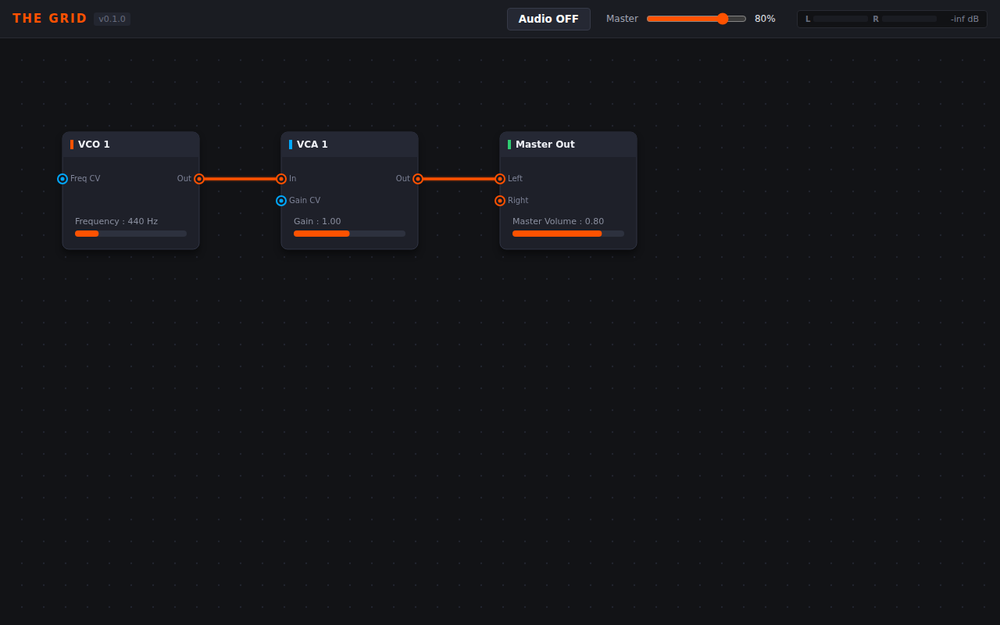

# Rendu Visuel du Frontend : The Grid (v0.1.0)

Voici la capture d'écran réelle de l'interface utilisateur de **The Grid** générée à partir du build de production (`Vite + TypeScript + Bun`) servie en résolution native 1280 × 800 :

---

## Détails des Composants Visuels

### 1. Barre Supérieure (Toolbar & Contrôles Host)
- **Logo & Versioning :** Typographie stylisée Bitwig avec accent orange `#ff5200` et badge `v0.1.0`.
- **Power Button (`Audio OFF` / `Audio ON`) :** Bouton à retour d'état visuel synchronisé avec les commandes IPC Tauri (`start_audio` / `stop_audio`).
- **Boutons Save / Load :** Sauvegarde et chargement de patchs au format standard JSON (`.grid.json`).
- **Master Slider :** Potentiomètre numérique de contrôle du gain général (`set_master_gain`).
- **Vu-Mètre Stéréo Décimé :**
  - Barres de niveau dédiées pour les canaux **L** et **R** avec dégradé vert $\rightarrow$ jaune $\rightarrow$ rouge.
  - Afficheur numérique calibré en dBFS (`-inf dB` à `+0.0 dB`), directement alimenté par l'événement Tauri `telemetry_update` cadencé à 60 Hz sans surcharge du thread audio.

### 2. Espace Modulaire Canvas 2D (Performance 60/120 FPS)
- **Grille de points :** Matrice de repère spatial (pas de 28px).
- **Modules du Patch Initial (`currentPatch`) :**
  - **`VCO 1` (Oscillateur) :** Entrée de modulation de fréquence (`Freq CV`), sortie audio (`Out`), slider de fréquence (440 Hz).
  - **`VCA 1` (Gain contrôlé en tension) :** Entrée audio (`In`), entrée de contrôle de gain (`Gain CV`), sortie audio (`Out`).
  - **`Master Out` (Sortie générale) :** Entrées stéréo gauche (`Left`) et droite (`Right`).
- **Câblage Virtuel en Courbes de Bézier Cubiques :**
  - Calcul dynamique de tangente en fonction de l'orientation et de la distance entre modules.
  - Code couleur par type de signal conforme à [`SPECIFICATIONS.md`](SPECIFICATIONS.md) :
    - **Orange vif (`#ff5200`) :** Signaux au débit audio (`Audio Rate`).
    - **Bleu électrique (`#00a8ff`) :** Tensions de contrôle (`Control Voltage / CV`).
    - **Jaune (`#ffd32a`) :** Impulsions et déclencheurs (`Trigger / Gate`).
  - Effet de halo lumineux accentué sur les connexions actives.
